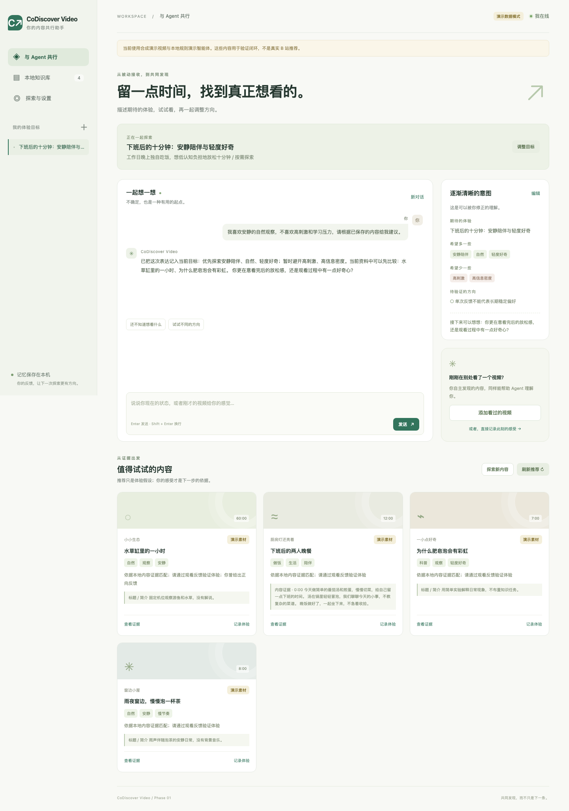
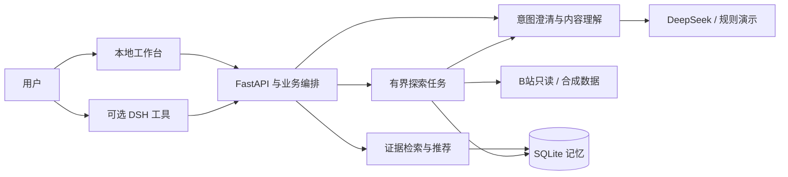

# CoDiscover Video

**和 Agent 一起发现值得看的内容。**  
*A local, user-controlled agent for video discovery and evidence-grounded recommendations.*

CoDiscover Video 是一个本地运行的视频发现助手。你可以从“下班后想放松，但不知道看什么”这样不完整的期待开始，通过对话、试看和反馈逐步明确方向；Agent 则负责探索内容、整理证据，并提供可解释、可修改的推荐。

它把**目标、内容证据和用户反馈**连接成一个可重复的协作过程。当前版本支持合成演示数据，以及 B 站只读采集与 DeepSeek Flash；也可以作为原生工具接入 DeepSeek Harness（DSH）。

> **版本状态：0.1.0，本地单用户原型。** 适合学习 Agent 工程、复现内容发现流程和探索产品设计。它不是 B 站官方产品，不接入平台内部推荐数据，也没有经过真实用户效果研究或生产级公网部署验证。



[快速开始](#快速开始) · [可重复示例](#可重复示例) · [真实模式](#使用真实-b-站与-deepseek) · [架构](#架构与工程机制) · [开发与验证](#开发与验证) · [数据与隐私](#数据与隐私)

## 为什么做这个项目

观看记录能反映行为，却未必能完整表达用户此刻想获得的体验。同样是观看生活视频，用户可能想要安静陪伴、轻度好奇，也可能只是想暂时离开工作。单次搜索通常还要求用户先知道该用什么关键词。

CoDiscover Video 尝试为这个过程增加一个可操作的协作层：

1. **从模糊期待开始。** 保留用户原话、场景和待验证假设，不急于把用户固定成某种类型。
2. **拿证据讨论候选。** 将字幕片段、采样画面和元信息分开处理，说明推荐依据与未知之处。
3. **用实际反馈修正方向。** 用户可以拒绝、改口、手动编辑意图，也可以反馈自己在别处发现的视频。
4. **把发现过程持续下来。** 用户离开工作台时，已开启的定时探索可以继续积累候选与证据。

项目的价值在于让推荐目标和调整过程对用户可见、可控。它没有声称比平台推荐更准确，也不会把观看时长或一次评分直接当成长期满意度。

## 功能

| 场景 | 当前实现 |
| --- | --- |
| 表达一个模糊需求 | 创建体验目标；通过多轮对话澄清，区分明确偏好、排除项与待验证假设 |
| 调整 Agent 的理解 | 直接编辑目标、场景和意图，不必通过反复对话纠正 |
| 探索新内容 | 手动或定时运行：规划搜索词 → 搜索 → 读取证据 → 分析 → 本地入库 |
| 检查推荐理由 | 查看来源、时间戳、字幕原文或有限采样画面；明确显示仅元信息的候选 |
| 记录真实体验 | 给推荐视频、自行导入的视频评分；也可保存不针对具体视频的自由反馈 |
| 暂停与恢复工作 | 登录需求触发暂停；支持取消、检查点恢复、阶段事件和调用用量记录 |
| 管理本地记忆 | 搜索知识库、导出目标与内容及反馈、清除本地业务记录 |
| 使用其他交互宿主 | DSH 原生 8 工具桥接，以及独立的只读 MCP 采集接口 |

当前不包含自动读取观看历史、浏览器播放监控、跨用户协同过滤、全片下载或 ASR、作者侧系统、多用户账号隔离。平台能力仅用于读取内容，不评论、不私信、不修改关注或收藏。

## 快速开始

### 环境

- Python **3.11+** 与 [uv](https://docs.astral.sh/uv/)。
- macOS 或 Linux；后台进程锁使用 POSIX `fcntl`。Windows 可在 WSL 中运行，原生 Windows 暂不支持。
- 仅运行工作台不需要 Node.js。DSH 集成需要 Node.js **24.9.0+**；浏览器测试需要 Node.js 和 Chromium。

取得本仓库源码并进入项目目录后：

```bash
uv sync --frozen
make demo
```

打开 [http://127.0.0.1:8765](http://127.0.0.1:8765)。`make demo` 强制使用演示数据和本地规则，并将运行数据写入 `data/demo/`。**不需要 API Key、B 站登录或额外模型下载。** 首次安装 Python 依赖仍需访问包仓库。

没有 `make` 时可以运行：

```bash
CDV_PROVIDER=demo CDV_LLM=demo CDV_DATA_DIR=data/demo uv run codiscover-video serve
```

创建“下班后安静放松”的目标，点击“探索新内容”，等待任务完成，再查看证据、对话和记录反馈。界面内的演示素材均为虚构内容，没有伪造的真实视频播放链接。更详细的操作见 [工作台演示](docs/DEMO.md)。

若默认端口已被占用，使用 `serve --port 8766` 并访问对应端口。

## 可重复示例

公开版本包含 **12 条人工编写的合成视频语料**，覆盖自然观察、料理、手工、科普、游戏等不同方向。题目、作者、字幕和时间戳都是测试素材，不是从真实平台抓取的数据。

“下班后的十分钟”示例展示以下过程：

- 从放松需求开始，完成一次有界探索并取得带证据的候选。
- 通过明确表达和反馈调整方向。
- 在当前目标中排除一条低评分视频，同时验证其他目标不受影响。
- 输出结构化结果，检查引用、证据和反馈保存情况。

```bash
uv run python scripts/run_example.py
# 可选：把本次运行报告保存到被 Git 忽略的目录
uv run python scripts/run_example.py --output data/example-result.json
```

该脚本固定使用 `demo` 数据源与规则引擎，在临时 SQLite 中运行，不读取 `.env`、不联网、不使用个人账号或付费模型。输出用于说明系统行为，不代表真实推荐质量。

[示例说明与数据约定](examples/README.md) · [场景输入](examples/after_work/scenario.json) · [合成视频语料](src/codiscover_video/fixtures/demo_videos.json)

## 使用真实 B 站与 DeepSeek

真实模式是可选功能。需要自己的 DeepSeek API Key；真实模型调用会产生用量。B 站字幕通常需要登录，部分视频可能没有可读取字幕或故事板。

先安装采集依赖并创建本地配置。已有 `.env` 时请保留原文件、按需编辑。

```bash
uv sync --frozen --extra bilibili
cp -n .env.example .env
```

在 `.env` 中设置：

```dotenv
CDV_PROVIDER=bilibili
CDV_LLM=deepseek
CDV_DATA_DIR=data/live
DEEPSEEK_API_KEY=your-own-key
DEEPSEEK_API_BASE=https://api.deepseek.com
CDV_SCHEDULER=true
CDV_MAX_DAILY_JOBS=12
```

```bash
uv run codiscover-video doctor
uv run codiscover-video serve
```

进入“探索与设置”，按需生成 B 站二维码，在手机 App 确认，再检查登录状态。凭证保存在本机数据目录的 `bili_credential.json` 中。账号限制、凭证过期或上游接口变化可能使采集失败；系统会显示错误、暂停或降低证据等级，不保证所有视频都可读取。

### 配置

| 变量 | 默认值 | 作用 |
| --- | --- | --- |
| `CDV_PROVIDER` | `demo` | 数据源：`demo` / `bilibili` |
| `CDV_LLM` | `demo` | 推理模式：`demo` / `deepseek` |
| `CDV_DATA_DIR` | `data` | 本地数据库与运行数据目录 |
| `CDV_SCHEDULER` | `true` | 是否允许为已开启定时的目标创建自动任务 |
| `CDV_MAX_DAILY_JOBS` | `12` | 自动调度的每日任务计数阈值 |
| `DEEPSEEK_API_KEY` | 空 | 仅真实模型模式需要；不要写入源码或提交到 Git |
| `DEEPSEEK_API_BASE` | `https://api.deepseek.com` | 模型 API 基址 |
| `BILI_CREDENTIAL_PATH` | 数据目录下的 `bili_credential.json` | 可选的本地凭证路径 |

模型固定为 `deepseek-flash`。环境变量优先于当前工作目录的 `.env`；更改配置后需重启服务。完整配置与命名说明见 [配置参考](docs/CONFIGURATION.md)。`demo + deepseek` 可用合成内容单独验证真实模型，`bilibili + demo` 可用于采集排障，但后者不具备真实大模型分析能力。

### “离线探索”如何工作

这里的“离线”指**用户离开工作台**，不是电脑断网。`serve` 同时启动 API 和 worker；电脑、网络和进程仍需运行，机器休眠或进程退出后不会有云端服务接管。

- 新目标默认只手动探索；用户主动开启定时后才会自动运行，间隔至少 15 分钟。
- 工作台在线时每 20 秒续期，在线租约为 45 秒；也可以手动切换离线状态。
- 在线状态阻止新的自动探索，不中断已开始或手动创建的任务。
- 默认每轮最多处理 4 条视频，API 可设为 1–12 条；模型尝试预算与单轮视频上限绑定。
- 每日阈值按 UTC 日期统计当天创建的任务，包含手动任务；它限制新的自动调度，不阻止显式手动任务。
- 同一数据目录只允许一个 worker，不能同时运行 `serve` 与 `worker`。

仅运行后台任务时可用 `uv run codiscover-video worker`；它不提供网页，目标需事先配置。恢复、预算和取消语义见 [架构文档](docs/ARCHITECTURE.md)。

## 架构与工程机制



| 模块 | 主要职责 |
| --- | --- |
| `app.py` / `models.py` | HTTP API、类型契约、输入约束与本机请求边界 |
| `service.py` / `intelligence.py` | 在线业务编排、搜索规划、证据分析和可编辑意图 |
| `jobs.py` / `llm.py` | 持久化任务状态、检查点、调用预算、有限重试与结构化输出校验 |
| `store.py` / `retrieval.py` | SQLite WAL、字幕切块、FTS、检索融合、反馈与多样性重排 |
| `providers/` / `vendor/` | 统一数据源接口、只读 MCP、固定上游的采集实现 |
| `static/` / `integrations/dsh/` | 无构建步骤的工作台、原生 DSH 工具桥接 |

几个有意保留的工程边界：

- **有界执行。** 最多 3 个搜索词，按任务限制视频数和模型尝试数；记录阶段事件、错误分类与用量。
- **幂等入库。** 同一视频更新时，在事务内替换内容分块和 FTS；恢复跳过已有检查点。外部请求仍可能在崩溃窗口内重复，不承诺 exactly-once。
- **证据分级。** 字幕保留时间戳；帧只代表有限画面；仅元信息不冒充已理解正文。内容置信度不是用户满意度概率。
- **目标级反馈。** 负反馈影响当前目标，不自动成为全局黑名单；用户表达、原始证据与模型推断分别保留。
- **可复现的 RAG 基线。** SQLite FTS5 BM25 + 256 维词法哈希向量融合，再用偏好过滤、评分与 MMR 风格选择重排。哈希向量不是语义 embedding，当前也不是大规模向量数据库。

[完整架构与取舍](docs/ARCHITECTURE.md) · [DSH / MCP 接入](integrations/dsh/README.md) · [本地 OpenAPI](http://127.0.0.1:8765/docs)

## 数据与隐私

公开仓库只保留源码、测试用合成数据、场景输入和合成演示截图。真实字幕与画面、账号凭证、用户对话、反馈、SQLite 数据库、二维码和本机验收日志不随源码发布。具体数据来源、用途和发布边界见 [示例说明](examples/README.md)。

业务记忆保存在本机，但**真实 DeepSeek 模式会将必要的目标、对话、反馈、字幕片段或采样画面发送给所配置的模型服务**。B 站登录凭证不作为模型输入。导出的记忆 JSON 可能包含个人内容，即使没有密钥，也不应直接当成公开示例上传。

服务只监听 `127.0.0.1`，适合可信本机使用；没有公网部署所需的多用户鉴权与隔离。使用平台采集功能时，应遵守平台规则并尊重内容作者的权利。[安全边界与问题报告](SECURITY.md)

## 开发与验证

```bash
uv sync --frozen --extra dev --extra bilibili
make lint
uv run pytest -q
node --test integrations/dsh/tests/*.test.mjs
make evaluate
```

普通测试使用合成数据或模拟响应，不默认调用付费模型。DSH 真实宿主激活测试需先按 [集成指南](integrations/dsh/README.md)安装本地 runtime；未安装时会明确跳过。浏览器完整流程测试的安装与运行方式见 [浏览器测试指南](tests/browser/README.md)。

`make evaluate` 使用固定的 12 条合成素材和 4 组查询，输出到 `data/evaluation.json`。这些结果用于正确性回归，不是独立真实用户测试集上的效果指标。可重复检查与发布版验证说明见 [验证记录](docs/VALIDATION.md)。

需要真实 API 验证时，请先阅读脚本用途并显式执行：

```bash
# 用合成内容验证真实 DeepSeek；需要自己的密钥，会产生模型用量
uv run python scripts/smoke_live.py --output data/live-smoke.json
# 已登录且服务运行后，用自己选择的公开 BV 号验收字幕闭环
uv run python scripts/subtitle_e2e.py --video-id YOUR_BV_ID
```

### 后续方向

后续工作优先建立独立评估集，再选择少量模块优化：语义检索与重排、较大语料索引、采集缓存、重试与队列背压，以及基于多次真实反馈的体验稳定性研究。作者侧协作属于后续研究方向，当前未实现。[路线图](docs/ROADMAP.md)

## 贡献与帮助

欢迎提供可复现问题、文档改进、失败场景测试和有测量依据的优化。开始前请阅读 [贡献指南](CONTRIBUTING.md)；公开远程仓库建立后，普通问题可通过仓库 Issues 交流。请勿在 Issue、截图或日志中提交密钥、Cookie、真实对话或账号信息。安全问题请按 [SECURITY.md](SECURITY.md)处理。

项目由 CoDiscover Video contributors 共同维护；具体贡献以发布仓库的提交与 Pull Request 历史为准。

## 许可证与致谢

项目使用 [MIT License](LICENSE)。第三方代码保留其原版权与许可证，详见 [NOTICE.md](NOTICE.md) 和 [上游来源记录](src/codiscover_video/vendor/UPSTREAM.md)。

B 站搜索、字幕、视频信息和故事板能力改编自 [dsh-bili-scroll](https://github.com/c1overzz/dsh-bili-scroll) 及其内置 bilibili-mcp，固定上游 commit 为 `6f3ab83993ccc51df9331048a8f9a51bef19bc28`。本项目增加目标与反馈记忆、意图协作、本地 RAG、有界任务编排和工作台；[DeepSeek Harness](https://github.com/deepseek-ai/deepseek-harness) 是可选交互宿主。合成示例不代表这些上游项目或真实平台的内容。
