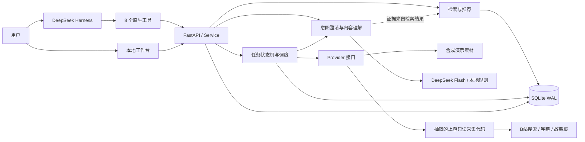
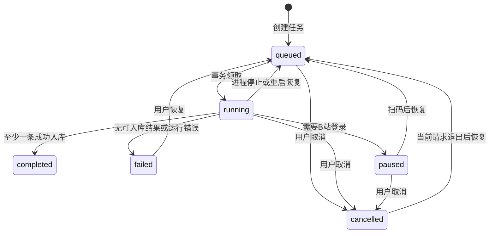

# 第一阶段架构与设计决策

CoDiscover Video 将“理解用户要什么”和“从平台取到什么”分成独立模块，再通过持久化目标与证据连接。第一阶段采用本地单用户、单 worker 架构，优先保证完整流程、可追溯性和失败恢复。

## 系统边界

DSH 是可选交互宿主。项目自身的 worker 负责离线执行，DSH 不需要持续保持一段对话来代替调度器。工作台与 DSH 插件共用本地 API 和数据库；它们不会各自维护一份互不一致的用户画像。

另提供独立 stdio MCP server，暴露 `video_search`、`video_inspect`、`source_health` 三个只读采集工具。它是采集边界，不替代包含目标、记忆和反馈的 DSH 插件。

## 模块职责

| 模块 | 负责 | 不负责 |
| --- | --- | --- |
| `models.py` / `app.py` | Pydantic 输入约束、HTTP 路由、同源请求检查 | 推荐算法与平台协议细节 |
| `service.py` | 目标、会话、导入和在线对话的业务编排 | 自主无限工具循环 |
| `jobs.py` | 任务领取、调度、预算、检查点、暂停恢复 | 以“用户停留时长”为优化目标 |
| `intelligence.py` | 生成搜索词、理解内容证据、澄清可编辑意图 | 执行外部内容中的命令 |
| `llm.py` | API 协议、限时请求、重试、结构与业务校验 | 数据库写入、任意模型工具执行 |
| `providers/` | 统一 `search`、`inspect`、`health`；登录与采集错误分类 | 排序、长期画像与用户评分推测 |
| `store.py` | 事务、SQLite 表、FTS 索引、导出与清理 | 在多个线程共享同一个连接 |
| `retrieval.py` | 证据分块、检索融合、偏好约束、反馈与多样性 | 训练语义向量模型 |
| `integrations/dsh/` | 注册 DSH 工具，校验本机 API 地址并桥接调用 | 公网转发、平台写操作或 shell 工具 |

## 在线链路

1. 用户新建目标，保存目标原文、场景、可编辑 `Intent` 和调度设置。
2. 每轮对话锁定该目标，避免同一目标的并发回复覆盖较新的理解。
3. 根据本轮消息、当前意图与本地内容执行检索，构造有限候选与证据片段。
4. `Intelligence.chat` 读取必要历史、反馈和候选，产生结构化回复、意图和引用 ID。
5. 校验引用是否属于提供的候选；合并明确表达的偏好，保留尚待验证假设。
6. 模型成功后持久化用户消息、助手消息和更新后的意图，再重新生成推荐。

用户可以从界面直接修改偏好，不需要“说服”模型。视频评分绑定 `goal_id`：同一视频在“下班放松”和“系统学习”目标下的反馈互不混用。最新 1–2 分将该视频从当前目标的推荐中排除，4–5 分提供加分；无视频反馈供后续规划与对话使用，不凭空建立视频偏好。

这里没有训练用户向量，也没有将一次观看当成永久偏好。当前偏好合并采用有限规则，复杂的间接否定、跨语言和隐含改口仍需用户在意图编辑器中核对。

## 离线任务与恢复

`completed` 表示至少一条内容成功入库；单条失败可记录在 `skipped` 中，因此需结合任务结果判断是否全部成功。

执行过程是有界状态机：规划最多 3 个搜索词，每轮视频数 `N` 限制为 1–12，限制候选处理量，模型 HTTP 尝试预算为 `2N + 4`。预算包括重试，恢复任务沿用已有调用数。它具备模型参与的规划与理解，但没有交给模型任意 shell、文件系统或无限反思循环。

每次处理视频后保存 `video_ids`、搜索计划、跳过原因和用量记录。数据库按视频 ID 做 upsert，视频、切块、FTS 索引在同一事务中更新；重复导入不会无限堆积同一视频的索引。进程重启时将遗留 `running` 转回 `queued`，恢复后跳过已经入库的视频。

恢复语义是“可能重做未完成步骤 + 幂等入库”，不是外部请求 exactly-once。进程如果恰好在请求已执行、检查点尚未保存时崩溃，恢复可能再次请求平台或模型；第一阶段不保证这类情况下付费调用绝不重复。

SQLite 使用 WAL、外键和 busy timeout。任务领取使用 `BEGIN IMMEDIATE`，进程锁确保同一数据目录只有一个 worker；操作系统会在进程退出后释放锁。模型调用还受到服务级信号量约束。

## 调度与在线状态

在线状态采用 45 秒租约，工作台在线时每 20 秒续期。它代表用户是否愿意让 Agent 开始新的自动探索，不是用户在 B 站真实观看状态的监测。

调度器只在租约过期或用户主动标记离线时，为已启用、已到期目标创建任务；首次开启目标且没有历史调度时间时，可立即安排第一轮。最短间隔为 15 分钟，调度产生的任务默认处理 4 个视频。每日阈值默认 12，以 UTC 日期统计当天任务，包含手动任务；达到阈值后停止自动创建，不阻止用户手动发起。

持久化的是任务与目标调度时间，在线租约只在内存中。服务停止时不会有云端进程代为工作。在线恢复也不会强行打断已经运行的探索，用户可以单独取消。

## 内容证据与降级

| 内容状态 | 可据此说什么 | 不应据此说什么 |
| --- | --- | --- |
| `subtitle` | 给出的字幕说了什么；引用保留时间戳 | 仅凭文字声称音色、语速、剪辑或已看完整视频 |
| `frames` | 有限故事板采样帧中的可见内容 | 全片叙事、音频体验或长期风格稳定性 |
| `metadata_only` | 标题、简介、标签指向的候选主题 | 已理解视频正文或已验证用户观看体验 |

B 站适配器先尝试字幕，再尝试故事板；需要凭证且没有可用替代证据时抛出 `LoginRequired`。字幕时间戳保留到 RAG 切块。帧数量、下载大小和来源 URL 有边界校验，传给模型的是选定采样帧。

模型内容分析会校验引用是否逐字来自已提供的字幕。仅元信息的置信度上限为 0.3，有限采样帧为 0.55，字幕为 0.85；这些是保守的工程分档，不是经过校准的正确率或用户满意度概率。

## 本地 RAG 基线

1. 元信息独立成块；字幕按约 500 字符组成窗口，保留一个片段重叠和起止时间。当前为小规模语料设计，单视频最多处理 3,000 个字幕片段。
2. 中文采用单字与相邻双字 token，英文/数字采用词 token。
3. SQLite FTS5 做 BM25；同一 token 集通过稳定哈希映射成 256 维词法向量，计算余弦相似度。
4. 采用基于名次的融合，候选还需与查询共享实际词或中文双字，防止哈希碰撞单独构成相关性证据。
5. 视频级排序结合检索相关性、内容置信度、明确正负偏好和目标内最近评分。
6. MMR 风格的贪心选择惩罚与已选视频的相似性及重复作者，避免一屏都是同一方向。

哈希向量属于词法特征，不是预训练语义 embedding；全量向量扫描也不是 ANN 向量索引。这个设计让第一阶段无额外模型下载即可复现，替换点集中在编码器、检索器与重排函数。没有证据相关性时返回空结果，而不是为填满卡片强行推荐。

## DeepSeek 协议与失败策略

固定调用 `deepseek-flash` Chat Completions，当前结构化任务关闭 thinking，使用 JSON 输出与 Pydantic schema 校验。每个逻辑生成允许最多一次结构/证据修复；每次 HTTP 请求对超时、429 和部分 5xx 等暂时错误进行最多 3 次有限尝试。401/402 分别标记凭证与账户问题，不原样无限重试。

只接受 `finish_reason=stop` 的完整结果；截断、工具调用、过滤及异常响应均不当成有效最终回答。模型返回的工具调用不会由此客户端执行。

每轮任务通过 `ContextVar` 归集调用预算和记录，包括模型、响应 ID、HTTP 状态、耗时、finish reason 和安全的 token 用量字段。既不持久化思考内容，也不把授权头与原始 API 错误正文写进任务记录。

## 数据与部署边界

数据库包含目标、视频、chunks、FTS、反馈、会话、消息、任务、事件和状态表。模式为本机单用户；没有跨用户行为矩阵。导出包含本地业务记忆，不包含 API Key 或 B 站凭证。清理会先检查仍在运行的任务、导入和对话，避免清空后被旧请求回写。

持久化在本机不等于模型计算不出机：启用 DeepSeek 后，完成任务所需的内容和用户上下文会发送给配置的模型服务。凭证不作为模型输入。浏览器用文本节点显示外部内容，后端限制本机和同源写请求，DSH 桥接只接受 loopback HTTP 地址。

该边界适合本地开发与演示，不能直接当成已支持公网多租户的部署方案。正式公网运行还需要鉴权、用户隔离、审计和部署治理。

## 可验证性与下一阶段

当前测试覆盖工作流、偏好负反馈、结构化模型协议、内容证据、任务恢复和并发边界；DSH 侧另有真实宿主注册与本地 HTTP 桥接测试。固定合成语料评估用于回归排错，不证明真实用户满意度提升。

第二阶段应先建立独立评估集，再选择语义检索或任务执行中的少数瓶颈优化，保留同一模块边界与回归测试。具体候选见 [优化路线](ROADMAP.md)。
